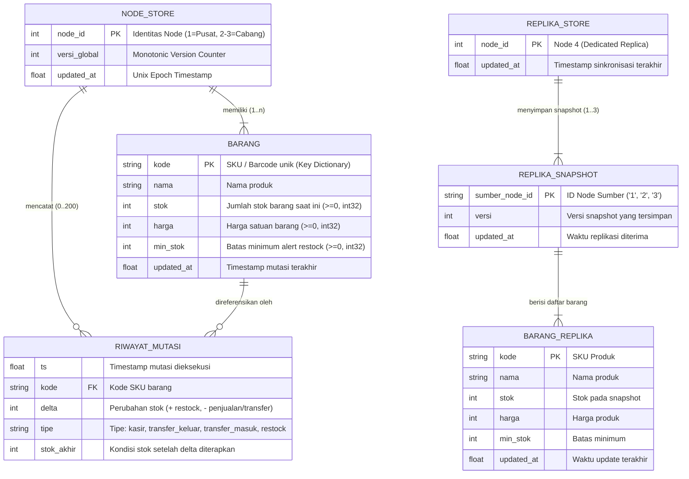
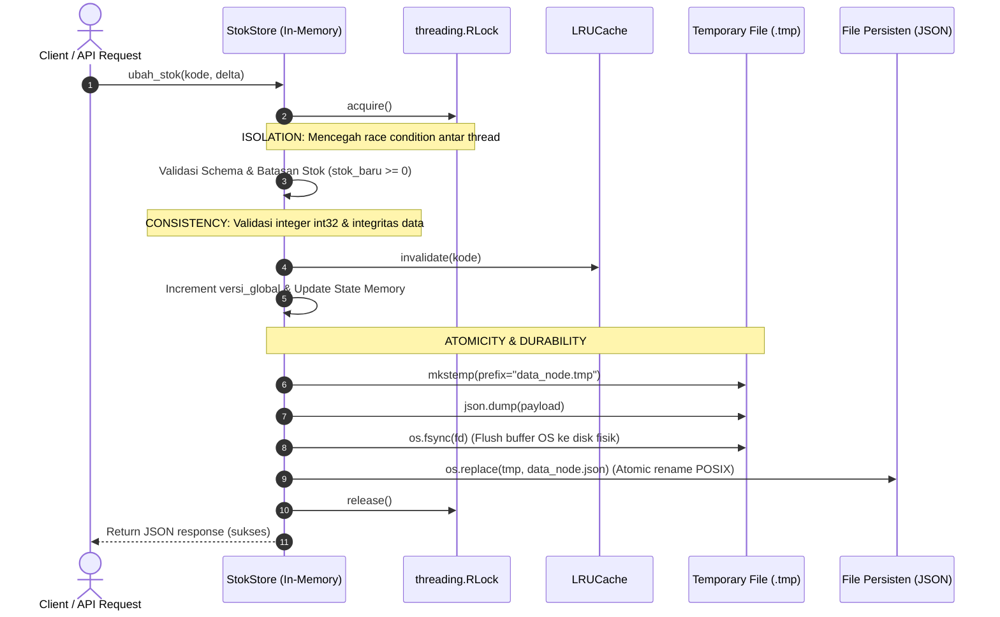

# Arsitektur Database & Penyimpanan Terdistribusi (DistriPOS)

Dokumen ini menyajikan pemodelan basis data, diagram relasional logis, struktur data persisten, dan mekanisme penyimpanan terdistribusi pada sistem DistriPOS. 

Meskipun sistem tidak memakai *Relational Database Management System* (RDBMS) seperti PostgreSQL atau MySQL, sistem ini menerapkan arsitektur **NoSQL Document Store / Key-Value File-based Persistence terdistribusi** yang memiliki skema ketat (*schema validation*), kontrol konkurensi, manajemen cache in-memory, serta jaminan properti ACID berbasis file atomik.

> **Cara Memvisualisasikan / Merender Diagram di Dokumen Ini:**  
> Seluruh diagram di dokumen ini dibuat menggunakan format **Mermaid**. Jika text editor (seperti VS Code bawaan atau editor teks biasa) tidak merender diagram secara otomatis, Anda dapat melihat/mengekspornya ke gambar (PNG/SVG) melalui:
> 1. **Online Web Renderer**: Buka [Mermaid Live Editor](https://mermaid.live), salin kode di dalam blok ```` ```mermaid ```` dan tempel ke editor tersebut.
> 2. **VS Code Extension**: Pasang ekstensi *Markdown Preview Mermaid Support* atau *Markdown Preview Enhanced*.
> 3. **CLI / Terminal**: Gunakan tool `@mermaid-js/mermaid-cli` (`npx @mermaid-js/mermaid-cli -i input.mmd -o diagram.png`).
> 4. **GitHub / GitLab**: Otomatis ter-render menjadi diagram interaktif saat file `.md` ini dilihat di repository GitHub/GitLab.

---

## 1. Konsep & Pemetaan ke Terminologi Database Tradisional

Dalam laporan atau presentasi sistem terdistribusi, penyimpanan berbasis JSON ini dapat dijelaskan melalui tabel analogi berikut:

| Konsep RDBMS Tradisional | Padanan di DistriPOS (JSON Storage) | Deskripsi Teknis |
|---|---|---|
| **Database Instance / Cluster** | **Cluster Multi-Node (`data/`)** | Setiap node fisik/proses memiliki dokumen database independen (Shared-Nothing Architecture). |
| **Database / Catalog** | File JSON Node (`data_node1.json`, dst.) | Dokumen JSON mandiri per partisi node. |
| **Tabel `products` / `barang`** | Objek Dictionary `barang` (Key: SKU) | Koleksi data barang dengan primary key berupa string `kode` (SKU). |
| **Tabel `stock_mutations`** | Array Objek `riwayat_mutasi` | Audit log pergerakan stok (append-only dengan rotasi maksimum 200 entri). |
| **Tabel `read_replica` / Snapshot** | File `replika_node4.json` | Dokumen replika terpusat di Node 4 yang menyimpan snapshot terindeks versi dari Node 1, 2, dan 3. |
| **Buffer Pool / Query Cache** | In-Memory `LRUCache` (`collections.OrderedDict`) | Cache di RAM dengan batas kapasitas (default 1000 entri) dan kebijakan pengusiran LRU (*Least Recently Used*). |
| **Database Transaction Engine** | `threading.RLock` + Atomic Rename POSIX | Menjamin isolasi lokal dan atomisitas penyimpanan tanpa data korup saat terjadi *crash*. |
| **Distributed Lock Manager (DLM)** | `LockManager` (Node 1 / Backup Node 4) | Mengunci record barang lintas node menggunakan *lease timeout* saat transfer stok. |

---

## 2. Diagram Relasional Logis (Entity-Relationship Diagram / ERD)

Walaupun data berformat JSON, entitas data memiliki keterhubungan logis yang terdefinisi dengan jelas:



---

## 3. Arsitektur Partisi dan Topologi Penyimpanan Terdistribusi

Sistem mengadopsi model **Partisi Horizontal Terdistribusi (Sharding by Node Role)** dan **Passive Single-Replica Node**:

```mermaid
graph TB
    subgraph Client_Layer["Application & Gateway Layer"]
        CLI["CLI / Web Dashboard"]
    end

    subgraph Cluster["Distributed Node Cluster"]
        subgraph Node1["Node 1 (Pusat & Primary LockManager)"]
            RAM1["RAM: LRU Cache + StokStore State"]
            FS1[("data/data_node1.json")]
            RAM1 -->|Atomic Save| FS1
        end

        subgraph Node2["Node 2 (Cabang A)"]
            RAM2["RAM: LRU Cache + StokStore State"]
            FS2[("data/data_node2.json")]
            RAM2 -->|Atomic Save| FS2
        end

        subgraph Node3["Node 3 (Cabang B)"]
            RAM3["RAM: LRU Cache + StokStore State"]
            FS3[("data/data_node3.json")]
            RAM3 -->|Atomic Save| FS3
        end

        subgraph Node4["Node 4 (Replika & Backup LockManager)"]
            RAM4["RAM: Replika Object State"]
            FS4[("data/replika_node4.json")]
            RAM4 -->|Atomic Save| FS4
        end
    end

    CLI -->|REST / RPC| Node1
    CLI -->|REST / RPC| Node2
    CLI -->|REST / RPC| Node3
    CLI -->|REST / RPC (Read-Only)| Node4

    Node1 -.->|Asynchronous Sync / RMI| Node4
    Node2 -.->|Asynchronous Sync / RMI| Node4
    Node3 -.->|Asynchronous Sync / RMI| Node4
    Node4 -.->|Two-Way Recovery / RMI| Node1
    Node4 -.->|Two-Way Recovery / RMI| Node2
    Node4 -.->|Two-Way Recovery / RMI| Node3
```

### Karakteristik Peran Partisi:
1. **Node 1, 2, 3 (Primary Partitions)**:
   - Menyimpan partisi stok lokal masing-masing di `data/data_node{1,2,3}.json`.
   - Node 1 menyimpan stok gudang pusat; Node 2 & 3 menyimpan stok ritel cabang.
   - Bersifat Read-Write dengan increment `versi_global` secara monotonik setiap ada transaksi penambahan/pengurangan stok.
2. **Node 4 (Read-Only Backup & Passive Replica)**:
   - Menyimpan seluruh salinan snapshot dari Node 1, 2, dan 3 dalam satu dokumen terisolasi `data/replika_node4.json`.
   - Menolak mutasi tulis langsung dari pengguna (HTTP 400).
   - Menjadi landasan **Two-Way Recovery**: jika Node 1, 2, atau 3 mengalami crash atau datanya hilang, node tersebut dapat menarik kembali snapshot terakhir dari Node 4.

---

## 4. Struktur Dokumen JSON (Data Dictionary & Schema)

### 4.1 Dokumen Penyimpanan Node Aktif (`data/data_node{1,2,3}.json`)

```json
{
  "node_id": 1,
  "versi_global": 42,
  "updated_at": 1795450767.7989826,
  "barang": {
    "BRG001": {
      "kode": "BRG001",
      "nama": "Teh Botol Sosro 250ml",
      "stok": 120,
      "harga": 5000,
      "min_stok": 20,
      "updated_at": 1795409613.9925146
    }
  },
  "riwayat_mutasi": [
    {
      "ts": 1795409613.9927008,
      "kode": "BRG001",
      "delta": 20,
      "tipe": "restock",
      "stok_akhir": 120
    }
  ]
}
```

#### Spesifikasi Field Node Store:
| Field | Tipe Data | Keterangan |
|---|---|---|
| `node_id` | `Integer` | ID Node (1, 2, atau 3). |
| `versi_global` | `Integer (int32)` | Penghitung versi dokumen; bertambah 1 setiap kali terjadi perubahan data. |
| `updated_at` | `Float64` | Waktu mutasi terakhir dalam format Unix timestamp (detik). |
| `barang` | `Map<String, Barang>` | Peta asosiatif SKU ke objek entitas barang. |
| `riwayat_mutasi` | `List<Mutasi>` | Riwayat mutasi berbatas (sliding window maks 200 item terakhir). |

#### Spesifikasi Field Entitas `Barang`:
| Field | Tipe Data | Validasi Batasan | Deskripsi |
|---|---|---|---|
| `kode` | `String` | Wajib non-kosong, harus sama dengan key dictionary | Primary key / SKU produk. |
| `nama` | `String` | Wajib non-kosong | Nama deskriptif barang. |
| `stok` | `Integer` | Rentang `[0, 2147483647]` (int32) | Kuantitas fisik barang yang tersedia. |
| `harga` | `Integer` | Rentang `[0, 2147483647]` (int32) | Harga jual satuan (Rupiah). |
| `min_stok` | `Integer` | Rentang `[0, 2147483647]` (int32) | Ambang peringatan stok menipis. |
| `updated_at` | `Float64` | Numerik | Waktu update barang terakhir. |

---

### 4.2 Dokumen Replika Snapshot (`data/replika_node4.json`)

```json
{
  "node_id": 4,
  "updated_at": 1795587539.7516854,
  "replikasi": {
    "1": {
      "versi": 42,
      "updated_at": 1795450767.8192174,
      "barang": { ... }
    },
    "2": {
      "versi": 15,
      "updated_at": 1795587539.7516704,
      "barang": { ... }
    },
    "3": {
      "versi": 9,
      "updated_at": 1795482904.3487093,
      "barang": { ... }
    }
  }
}
```

---

## 5. Alur Transaksi & Jaminan Properti ACID Berbasis File Atomik

Walaupun tidak menggunakan database server, sistem menerapkan prinsip **ACID** (*Atomicity, Consistency, Isolation, Durability*) melalui modul `src/common/core.py`:



### Mekanisme ACID di Level Kode:
1. **Atomicity (Semua atau Tidak Sama Sekali)**:
   - Penulisan ke disk tidak langsung menimpa file target.
   - Menggunakan `tempfile.mkstemp()` untuk membuat file `.tmp` sementara.
   - File sementara ditulis penuh, lalu dipindahkan menggunakan operasi sistem `os.replace()`. Pada sistem operasi POSIX dan Windows modern, `os.replace` adalah operasi *atomic rename* di level filesystem; jika sistem mati mendadak di tengah jalan, file asli tidak akan rusak atau terpotong (*no partial writes*).
2. **Consistency (Integritas Aturan Bisnis)**:
   - Validasi ketat dilakukan sebelum perubahan dimasukkan ke memori: teks non-kosong, nilai berada pada rentang batas 32-bit (`INT32_MIN` s.d. `INT32_MAX`), dan stok tidak boleh negatif (`stok_baru < 0` melempar `StokError(422)`).
3. **Isolation (Isolasi Antar Transaksi)**:
   - **Tingkat Node**: Menggunakan `threading.RLock()` di kelas `StokStore` dan `Replika`, sehingga seluruh operasi *read-modify-write* dieksekusi secara serial per thread.
   - **Tingkat Terdistribusi**: Menggunakan `LockManager` berbasis Pyro5 RMI dengan waktu sewa (*lease*) 10 detik saat melakukan transfer stok antar cabang guna mencegah *distributed race condition*.
4. **Durability (Daya Tahan Data)**:
   - Pemanggilan `os.fsync(stream.fileno())` sebelum operasi rename menjamin byte data benar-benar tersinkronisasi ke media penyimpanan magnetik/SSD dan tidak tertinggal di buffer OS.

---

## 6. Integrasi Caching (In-Memory LRU Cache)

Untuk mempercepat operasi pencarian (`ambil_barang`) tanpa harus membaca disk atau melakukan parsing JSON berulang-ulang:
- Setiap node mengoperasikan **`LRUCache`** berbasis `collections.OrderedDict`.
- Kapasitas cache dibatasi sebanyak **1000 SKU** per node.
- **Cache Invalidation**: Setiap kali ada operasi penulisan (`tambah_barang`, `ubah_stok`, `hapus_barang`), kunci SKU terkait langsung di-*invalidate* dari cache.
- **Cache Hit/Miss Monitoring**: Menyimpan metrik `hits` dan `misses` secara real-time yang dilaporkan pada endpoint `/status` dashboard.
