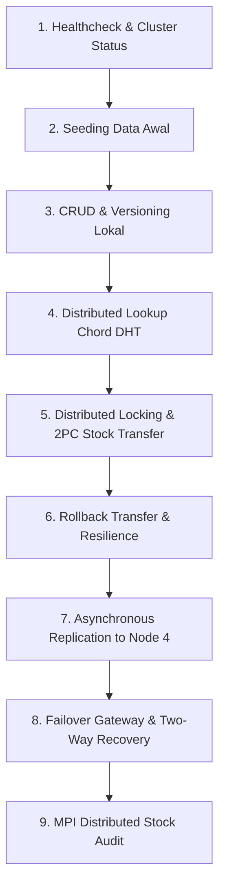

# Panduan Pengujian Menyeluruh (Testing Guide) DistriPOS

Panduan ini berisi alur langkah demi langkah (*step-by-step*) untuk menguji seluruh fitur sistem terdistribusi DistriPOS secara terstruktur, baik melalui **CLI** maupun **Web Dashboard**.

---

## 1. Persiapan Awal Lingkungan Pengujian

Sebelum memulai pengujian fitur, pastikan seluruh klaster berjalan dan berada dalam kondisi stabil:

### Jalankan Klaster:
Buka terminal utama dari root proyek:
```bash
# Aktifkan virtual environment
source .venv/bin/activate       # Linux/macOS
# atau .\.venv\Scripts\Activate.ps1 di Windows PowerShell

# Jalankan seluruh klaster node (Launcher :8000, Node 1-4 :8001-8004)
python launcher.py --auto-start
```
Buka Web Dashboard di browser: `http://localhost:8000`

---

## 2. Alur Pengujian Fitur demi Fitur

Alur berikut disusun sesuai urutan logis skenario operasional sistem ritel terdistribusi.



---

### Skenario 1: Cluster Healthcheck, Heartbeat & Port Check

**Tujuan:** Memastikan keempat node aktif dan mendeteksi kondisi satu sama lain.

- **Via CLI:**
  ```bash
  python cli.py status
  ```
  *Ekspektasi Output:*
  Menampilkan status node 1–4 aktif (`online`), status heartbeat hijau, versi global tiap node, dan metrik latency.
- **Via Web Dashboard:**
  - Buka tab/panel **Node Status / Cluster Overview**.
  - Amati indikator status Node 1 (Pusat), Node 2 (Cabang A), Node 3 (Cabang B), dan Node 4 (Replika).

---

### Skenario 2: Seeding Data Awal

**Tujuan:** Mengisi data awal dummy ke node tanpa menimpa data yang sudah ada (bersifat *idempotent*).

- **Via CLI:**
  ```bash
  python cli.py seed
  ```
  *Ekspektasi Output:*
  Mendapatkan status `HTTP 200 OK` dan daftar produk default (`SKU-001`, `SKU-002`, `SKU-003`) terbuat di Node 1.
- **Via Web Dashboard:**
  - Klik tombol **Seed Data Awal** pada panel Admin / Operasional.
  - Periksa tabel inventaris: item default muncul di daftar stok.

---

### Skenario 3: CRUD Produk, Mutasi Kasir, dan Increment Versi

**Tujuan:** Menguji validasi tipe data (int32, non-negatif), pencatatan audit log mutasi, dan kenaikan `versi_global`.

1. **Tambah Produk Baru di Node 2:**
   - **CLI:**
     ```bash
     python cli.py add TEST-01 "Kopi Susu Uji" 50 --harga 15000 --min-stok 10 --node 2
     ```
   - *Ekspektasi:* Produk berhasil dibuat dengan `stok: 50`. Versi Node 2 naik.

2. **Cek Detail Barang & Cache:**
   - **CLI:**
     ```bash
     python cli.py get TEST-01 --node 2
     ```
   - *Ekspektasi:* Data kembali sesuai. Panggilan kedua akan menaikkan hit counter pada `LRUCache`.

3. **Mutasi Stok Kasir (Penjualan / Pengurangan Stok):**
   - **CLI:**
     ```bash
     python cli.py stock TEST-01 -5 --tipe kasir --node 2
     ```
   - *Ekspektasi:* Stok berkurang menjadi 45. Riwayat mutasi tercatat dengan `delta: -5`. Versi global kembali naik.

4. **Uji Validasi: Stok Negatif Ditolak:**
   - **CLI:**
     ```bash
     python cli.py stock TEST-01 -100 --tipe kasir --node 2
     ```
   - *Ekspektasi:* Muncul error `HTTP 422 Unprocessable Entity` ("Stok tidak boleh negatif"). Nilai stok tidak berubah.

---

### Skenario 4: Distributed Hash Table (Chord DHT Lookup)

**Tujuan:** Menguji penentuan kepemilikan kunci SKU pada *ring* Chord yang didistribusikan secara terdesentralisasi.

- **Via CLI:**
  ```bash
  python cli.py dht TEST-01
  python cli.py dht SKU-001
  ```
- **Via Web Dashboard:**
  - Masukkan kode SKU pada fitur **Chord DHT Lookup**.
  - *Ekspektasi Output:*
    Menampilkan hash SHA-1 dari key, posisi identifier ring, node penanggung jawab (*successor/responsible node*), dan finger table yang dilalui.

---

### Skenario 5: Distributed Lock & Transfer Stok Lintas Cabang (Happy Path)

**Tujuan:** Menguji transfer stok dari Cabang 2 ke Cabang 3 dengan koordinasi Distributed Lock Manager (Node 1) via Pyro5 RMI.

- **Via CLI:**
  1. Siapkan stok awal di Node 2:
     ```bash
     python cli.py add TRF-01 "Barang Transfer" 100 --node 2
     ```
  2. Tambahkan juga SKU penampung di Node 3:
     ```bash
     python cli.py add TRF-01 "Barang Transfer" 0 --node 3
     ```
  3. Lakukan transfer sebanyak 20 unit:
     ```bash
     python cli.py transfer 2 3 TRF-01 20
     ```
  *Ekspektasi Output:*
  - `HTTP 200 OK`
  - Trace transaksi memperlihatkan urutan:
    1. `LockManager.acquire` pada Node 1 (berhasil).
    2. Debit stok di Node 2 (stok menjadi 80).
    3. Kredit stok di Node 3 (stok menjadi 20).
    4. `LockManager.release` pada Node 1.

---

### Skenario 6: Simulasi Kegagalan & Kompensasi Otomatis (Transfer Rollback)

**Tujuan:** Memastikan integritas data tetap terjaga saat transaksi terdistribusi gagal di tengah jalan (Two-Phase Commit / Compensating Transaction).

- **Via CLI:**
  ```bash
  python cli.py transfer 2 3 TRF-01 10 --simulasi-gagal
  ```
  *Ekspektasi Output:*
  - Mengembalikan `HTTP 502 Bad Gateway` (atau kegagalan yang diharapkan).
  - Trace memperlihatkan:
    1. Lock berhasil diambil.
    2. Debit di Node 2 sempat terjadi.
    3. Kredit di Node 3 disimulasikan gagal.
    4. **Rollback**: Node 2 secara otomatis melakukan refund/kredit kembali sejumlah unit yang didebit.
    5. Lock dilepas.
  - Periksa stok di Node 2:
    ```bash
    python cli.py get TRF-01 --node 2
    ```
    Stok Node 2 tetap utuh di angka 80 (tidak terjadi kebocoran stok).

---

### Skenario 7: Replikasi Snapshot Pasif ke Node 4

**Tujuan:** Memastikan Node 4 menerima snapshot secara asinkron dari node sumber dan menolak penulisan langsung.

1. **Periksa Status Replika:**
   - **CLI:**
     ```bash
     python cli.py replica
     ```
   - *Ekspektasi:* Terlihat snapshot untuk node 1, 2, dan 3 beserta nomor versi masing-masing.

2. **Trigger Sinkronisasi Ulang Manual:**
   - **CLI:**
     ```bash
     python cli.py sync
     ```
   - *Ekspektasi:* Node 4 mengonfirmasi status `diterapkan` atau `sudah_sama` untuk seluruh cabang aktif.

3. **Uji Validasi Read-Only Node 4:**
   - Cobalah menambah barang langsung ke Node 4:
     ```bash
     python cli.py add ILEGAL "Barang Ilegal" 10 --node 4
     ```
   - *Ekspektasi:* Penulisan **wajib ditolak** dengan `HTTP 400 Bad Request` ("Node 4 bersifat read-only / replika").

---

### Skenario 8: Gateway Failover & Two-Way Recovery

**Tujuan:** Menguji ketahanan sistem saat salah satu node gateway padam, serta memulihkan data lokal yang hilang dari snapshot Node 4.

1. **Uji Smart Gateway Failover:**
   - Hentikan proses Node 1 dari launcher dashboard atau matikan terminal Node 1.
   - Jalankan perintah CLI:
     ```bash
     python cli.py list --node 2
     ```
   - *Ekspektasi:* CLI Smart Gateway otomatis melakukan failover ke port Node 2/3 tanpa melempar crash ke user.

2. **Uji Two-Way Recovery (Pemulihan Data Rusak/Hilang):**
   - Hapus atau kosongkan isi file `data/data_node2.json` (mensimulasikan disk loss).
   - Nyalakan kembali Node 2 dan picu endpoint pemulihan:
     - Dashboard: Klik tombol **Pulihkan dari Replika** pada Node 2.
     - Atau via HTTP request ke Node 2: `POST http://localhost:8002/replika/pulihkan`.
   - *Ekspektasi:* Node 2 mengambil kembali data dari snapshot terakhir di Node 4 dan file `data/data_node2.json` pulih secara utuh.

---

### Skenario 9: Audit Stok Terdistribusi Berbasis MPI

**Tujuan:** Menjalankan audit analitik konsistensi stok terdistribusi lintas seluruh rank MPI.

- **Via CLI:**
  ```bash
  python cli.py mpi
  ```
- **Via Web Dashboard:**
  - Buka tab/panel **MPI Analytics / Distributed Audit**.
  - Klik tombol **Jalankan Audit MPI**.
  - *Ekspektasi Output:*
    Sistem mengeksekusi multi-rank reduction/gathering (atau simulasi 4 rank jika MPI runtime native tidak terpasang) dan menyajikan:
    - Total nilai valuasi stok seluruh toko.
    - Daftar SKU di bawah `min_stok` (peringatan restock).
    - Status konsistensi versi antara data primer vs replika Node 4.

---

## 3. Menjalankan Automated Test Suite

Untuk verifikasi regresi otomatis secara menyeluruh tanpa perlu mengetes manual satu per satu:

```bash
# 1. Cek sintaks dan kompilasi seluruh file
.venv/bin/python -m compileall -q src run_node.py launcher.py cli.py tests

# 2. Jalankan seluruh unit & integration tests Python
.venv/bin/python -m unittest discover tests

# 3. Jalankan automated test gateway & dashboard JS
node tests/dashboard_gateway.test.cjs
```
Semua test di atas harus menghasilkan status `OK` / passed.
