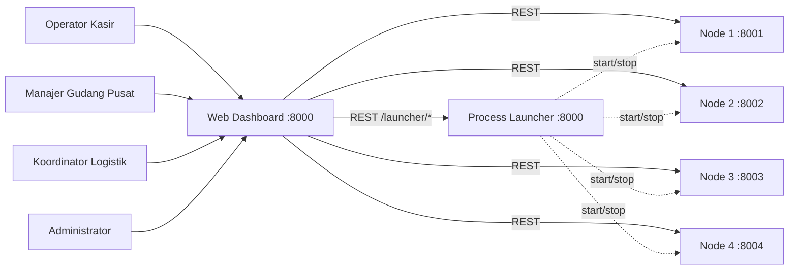
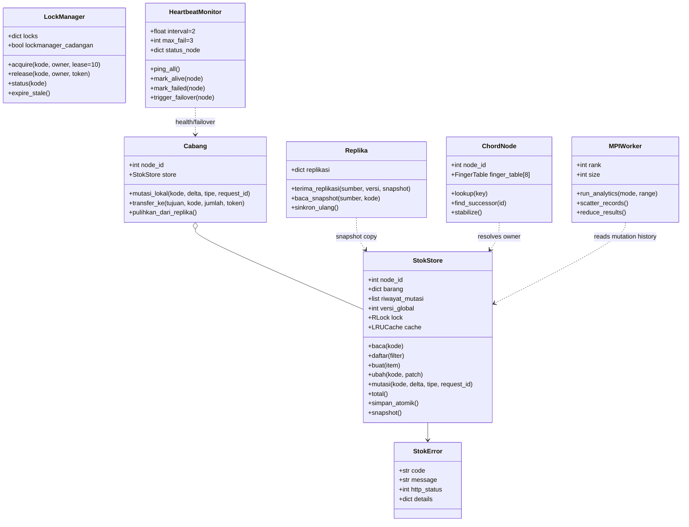
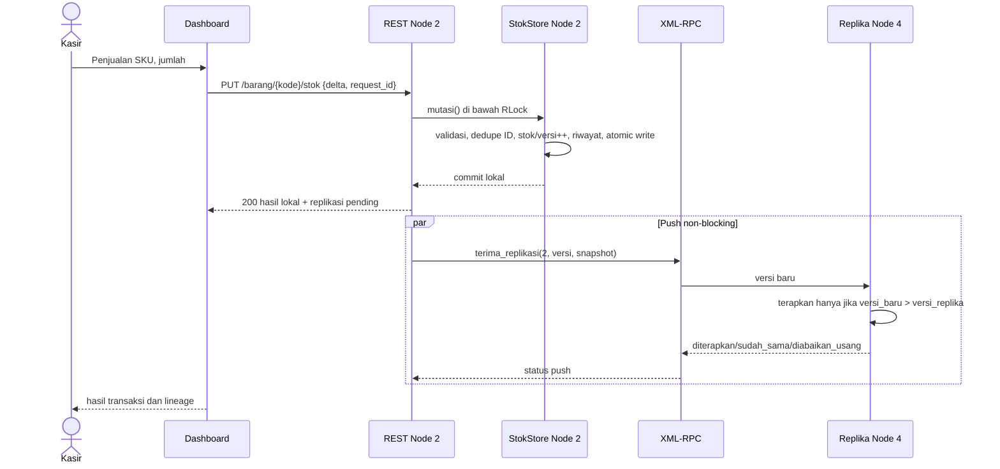
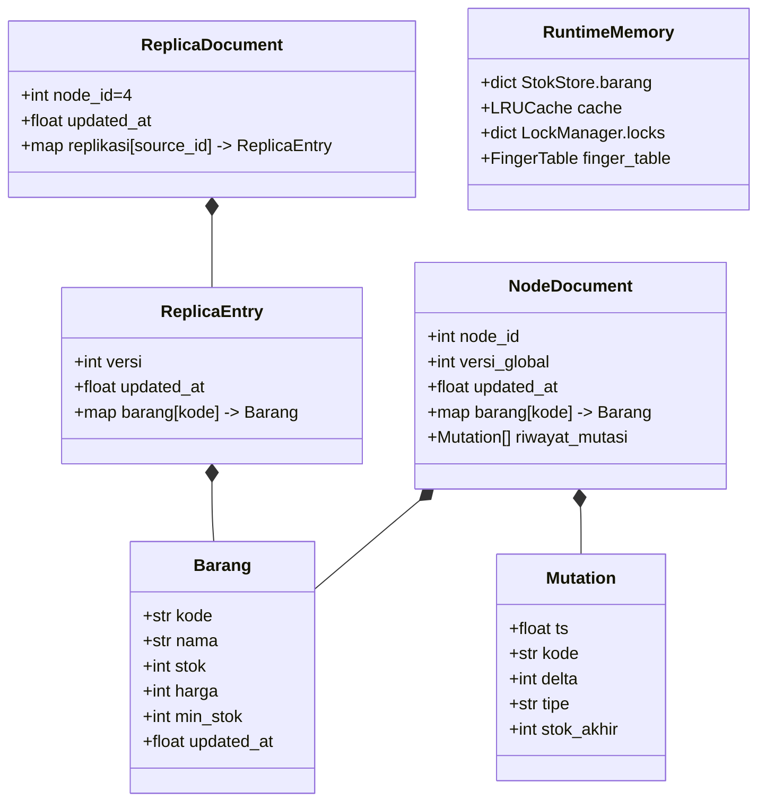

# Spesifikasi Teknis — DistriPOS & Branch Inventory Engine

**Versi:** 2.0 — lampiran spesifikasi implementasi  
**Status:** Kontrak integrasi backend, process launcher, dan dashboard  
**Bahasa:** Indonesia

> Dokumen ini melengkapi PRD v2.0. Aturan normatif yang diketahui dari PRD—topologi empat node, REST/XML-RPC/Pyro5/Chord/MPI, lease 10 detik, waktu tunggu lock 12 detik, heartbeat 2 detik dengan ambang 3 kegagalan, RPC timeout 3 detik, retry 1/2 detik, replikasi berdasarkan versi, dan Two-Way Recovery—dipertahankan. Rincian endpoint yang tidak tampak dalam kutipan PRD dikunci di sini sebagai kontrak integrasi tambahan; bila salinan penuh PRD menetapkan bentuk berbeda, PRD menjadi sumber kebenaran dan kontrak ini perlu diselaraskan.

## 1. Rancangan Aplikasi (Application Design)

### 1.1 Aktor, use case, dan alur dashboard

| Aktor | Use case utama | Interaksi |
|---|---|---|
| Operator Kasir Ritel Multi-Cabang | Melihat/mencari SKU, membaca stok, mencatat penjualan atau penerimaan lokal, memantau hasil transaksi | Dashboard memanggil REST API node cabang pada port 8002/8003. Lookup katalog menggunakan `/dht/lookup/{kode}`; mutasi menggunakan `/barang/{kode}/stok`. Hasil menampilkan node asal, versi, status, dan lineage `trace`. |
| Manajer Gudang Pusat | CRUD katalog, menyesuaikan stok pusat, memantau total dan cabang, menginisiasi/meninjau transfer, seed data, melihat status replika | Dashboard memanggil port 8001; operasi terdistribusi dilanjutkan melalui XML-RPC/Pyro5 sesuai operasi. Monitoring replika dan status menggunakan REST. |
| Koordinator Logistik Antar Cabang | Membuat transfer, memeriksa status lock, memantau node/transfer dan pemulihan | Dashboard mengirim `POST /transfer`, memeriksa `/lock`, `/cabang/{n}/info`, `/status`; keputusan transfer dikembalikan sukses atau gagal/rollback secara eksplisit. |
| Administrator/operator sistem | Memulai/menghentikan proses dan memeriksa kesehatan | Process Launcher di port 8000 menyediakan kontrol proses node melalui `/launcher/*`; dashboard memanggil launcher, bukan mengelola proses node langsung. |



Alur UI: pilih node/operasi → kirim REST JSON → tampilkan `data`, `error` (bila ada), dan daftar `trace` tanpa menghilangkan urutannya. Untuk kontrol lifecycle, UI memanggil launcher dan melakukan polling `/launcher/status`. CORS hanya mengizinkan origin dashboard `http://HOST_LAUNCHER:8000` menuju REST node 8001–8004; batasi method/header pada kebutuhan REST.

### 1.2 Struktur direktori target

```text
distributed-branch-inventory/
├── .env.example
├── requirements.txt
├── run_node.py
├── launcher.py
├── data/
│   ├── data_node1.json
│   ├── data_node2.json
│   ├── data_node3.json
│   └── replika_node4.json
├── src/
│   ├── common/
│   │   ├── config.py
│   │   ├── logger.py
│   │   ├── core.py
│   │   ├── chord_dht.py
│   │   ├── resilience.py
│   │   ├── heartbeat.py
│   │   ├── rpc_server.py
│   │   ├── rpc_client.py
│   │   ├── rmi_objects.py
│   │   ├── rmi_client.py
│   │   └── api.py
│   └── analytics/
│       └── mpi_analytics.py
├── dashboard/
│   ├── index.html
│   ├── style.css
│   └── app.js
└── docs/
    └── SPESIFIKASI_TEKNIS.md
```

### 1.3 Desain modular dan kelas



**Kontrak modular:** `StokStore` menjaga seluruh baca/tulis dokumen dan cache di bawah `threading.RLock`; jangan menahan lock saat menunggu jaringan. `mutasi` memvalidasi rentang integer dan request ID sebelum mengubah stok, versi, riwayat, lalu persistensi. Push replika dijadwalkan setelah commit lokal dan tidak menahan response kasir untuk replikasi best-effort. `LockManager` adalah objek Pyro5 stateful; operasi lock memiliki token/owner dan waktu kedaluwarsa monotonic. `Cabang` membungkus operasi transaksi node. `Replika` menyimpan salinan per sumber. MPI rank 0 mengoordinasi request; rank 0–3 membagi agregasi riwayat, dan hasil dikumpulkan dengan Reduce.

### 1.4 Kontrak API REST

Semua API node menggunakan `Content-Type: application/json`, port 8001–8004. Kecuali dinyatakan lain, response berbentuk:

```json
{"ok": true, "data": {}, "error": null, "node_id": 2, "versi_global": 17, "via": "REST", "node_tujuan": 2, "trace": []}
```

Kesalahan: `{"ok":false,"data":null,"error":{"code":"...","message":"...","details":{}},"node_id":2,"via":"REST","node_tujuan":2,"trace":[...]}` dengan HTTP 4xx untuk validasi/not-found/conflict dan 5xx untuk kegagalan layanan. Waktu timestamp berupa Unix epoch detik float UTC. `trace` berurutan dari hop pertama ke terakhir, tanpa rahasia/token.

```json
{"dari":1,"ke":4,"protokol":"XML-RPC","aksi":"terima_replikasi","ringkasan_data":"sumber=1 versi=18 sku=SKU-01","status":"ok"}
```

Enum `protokol`: `XML-RPC`, `Pyro5-RMI`, `FAILOVER`, `ROLLBACK`, `CHORD-DHT`, `MPI`. `dari`/`ke` integer node 1..4. Hop browser→node REST tidak dimasukkan dalam array karena bukan salah satu enum protokol lineage antarnode; metadata node API tetap di root response. Setiap perpindahan antarnode wajib menambahkan satu trace. Launcher bukan node; endpoint launcher menggunakan `node_id:null`, dan `trace:[]` kecuali proses node melakukan hop.

| Method & path | Request | Hasil/semantik |
|---|---|---|
| `GET /barang` | query opsional `q`, `limit`, `offset` | daftar barang; salinan hasil (`deepcopy`), cache lookup boleh dipakai |
| `POST /barang` | `{"kode":"...","nama":"...","stok":0,"harga":0,"min_stok":0}` | 201; buat SKU unik, versi bertambah, catat mutasi awal sesuai kebijakan tipe `seed`/`restock` |
| `GET /barang/{kode}` | — | item atau 404; cache LRU |
| `PUT /barang/{kode}` | field barang yang akan diganti | ganti atribut yang diizinkan; `kode` immutable; versi naik |
| `DELETE /barang/{kode}` | — | hapus item; 204/response JSON konsisten; versi naik |
| `PUT /barang/{kode}/stok` | `{"delta":-1,"tipe":"penjualan","request_id":"uuid"}` | mutasi lokal atomik dan idempoten terhadap `request_id`; 200 berisi item, versi, dan status push async |
| `GET /total` | — | total stok lokal dan jumlah SKU; bukan agregat nasional kecuali diminta MPI |
| `POST /transfer` | `{"dari":2,"ke":3,"kode":"SKU-01","jumlah":5,"request_id":"uuid"}` | transaksi terkoordinasi dengan lease; 200 sukses, kegagalan tujuan memicu rollback sebelum error dikembalikan |
| `GET /lock` | query `kode` opsional | status lease aktif; jangan mengembalikan token rahasia |
| `POST /lock` | `{"aksi":"acquire\|release","kode":"...","owner":"...","token":"..."}` | kontrol/admin; acquire lease default 10s, tunggu maksimum 12s; release wajib cocok owner/token |
| `GET /cabang/{n}/info` | `n=1..4` | metadata node, health, versi, kapabilitas, endpoint |
| `GET /replika` | — | ringkasan semua sumber/versi replika pada Node 4 |
| `GET /replika/{sumber}` | sumber 1..3 | metadata snapshot sumber; `?include_barang=true` untuk snapshot penuh |
| `POST /replika/sinkron_ulang` | `{"sumber":1}` atau `{}` | Node 4 menarik snapshot terbaru dari node sumber (atau semua sumber); hasil per sumber: `diterapkan`, `sudah_sama`, `diabaikan_usang` |
| `GET /status` | — | status node, heartbeat, peran, versi, cache/replika, failover aktif |
| `GET /ping/{n}` | — | liveness dan waktu respons target node |
| `POST /admin/delay/{n}` | `{"detik":1.5}` | injeksi delay untuk pengujian; validasi nilai nonnegatif dan batasi akses admin |
| `GET /dht/lookup/{kode}` | — | hasil node pemilik/lokasi SKU dan jalur lookup Chord; trace `CHORD-DHT` |
| `POST /analytics/mpi` | `{"operasi":"rekonsiliasi\|audit","dari_ts":0.0,"sampai_ts":null,"kode":null}` | rank 0 memulai kolektif MPI dan mengembalikan hasil agregasi, cakupan, rank, serta trace `MPI`; operasi sinkron dibatasi timeout atau dapat menerima job id bila long-running |
| `POST /admin/seed` | `{"barang":[...],"replace":false}` | idempoten untuk seed yang sama; hanya admin, validasi penuh, audit perubahan |

Kontrak launcher berjalan pada port 8000, prefiks `/launcher`:

| Method & path | Perilaku |
|---|---|
| `GET /launcher/status` | daftar node, PID, state (`running`, `stopped`, `starting`, `failed`), port dan health terakhir |
| `POST /launcher/start/{n}` | mulai node 1..4; 202 bila startup belum sehat, hasil/pid disediakan |
| `POST /launcher/stop/{n}` | hentikan node secara graceful lalu terminate setelah grace period; idempoten jika sudah berhenti |
| `POST /launcher/start_all` | mulai node sesuai urutan 1,2,3,4; health readiness tiap proses |
| `POST /launcher/stop_all` | hentikan 4,3,2,1 agar dependensi turun teratur |

Endpoint administrasi wajib dilindungi (minimal bind lokal/role token pada deployment), tidak diekspos ke jaringan publik. Request mutasi membawa `request_id` unik; pengulangan ID yang sama mengembalikan hasil tersimpan tanpa menerapkan delta kedua kali.

### 1.5 Diagram sequence skenario kritis

#### a. Transaksi kasir lokal dan asynchronous push



#### b. Transfer dengan distributed lease dan auto-rollback

```mermaid
sequenceDiagram
  participant Client as Dashboard/Koordinator
  participant API as REST coordinator (Node 1)
  participant LM as LockManager Pyro5
  participant Src as Cabang sumber
  participant Dst as Cabang tujuan
  participant Rep as Node 4
  Client->>API: POST /transfer {dari,ke,kode,jumlah,request_id}
  API->>LM: acquire(kode, owner, lease=10s), tunggu<=12s
  LM-->>API: token + expiry atau timeout
  API->>Src: mutasi -jumlah (request_id debit)
  Src-->>API: commit debit dan versi
  API->>Dst: mutasi +jumlah (request_id kredit)
  alt tujuan berhasil
    Dst-->>API: commit kredit dan versi
    API->>LM: release(token)
    par asynchronous replication
      Src->>Rep: push versi terbaru
      Dst->>Rep: push versi terbaru
    end
    API-->>Client: sukses; kedua mutasi + trace
  else gagal/timeout tujuan
    Dst-->>API: error/timeout
    API->>Src: kompensasi +jumlah (request_id rollback)
    Src-->>API: hasil kompensasi
    API->>LM: release(token) atau lease habis
    API-->>Client: gagal; rollback sukses/gagal tercatat
  end
```

Transfer menerapkan pola kompensasi, bukan transaksi atomik lintas file/node. Coordinator hanya menyatakan rollback berhasil setelah kredit kompensasi dikonfirmasi. Bila sumber tidak dapat dijangkau saat kompensasi, tandai transfer `IN_DOUBT`, simpan ledger/request ID untuk rekonsiliasi, jangan melaporkan sukses/rollback tuntas. Lease 10 detik adalah batas kepemilikan lock; timeout akuisisi maksimal 12 detik tidak memperpanjang lease secara implisit. Mutasi transfer harus selesai/renew secara eksplisit sebelum expiry.

#### c. Read failover dan Two-Way Recovery

```mermaid
sequenceDiagram
  participant C as Client
  participant N as Node 2
  participant H as Heartbeat/Resilience
  participant R as Node 4 Replika
  participant P as Node pulih
  C->>N: GET /barang/SKU-01
  N--xC: timeout / unavailable
  H->>N: heartbeat tiap 2s; gagal 3 kali
  H->>R: tandai Node 2 down; failover read
  R-->>C: snapshot Node 2 + trace FAILOVER (jika retry oleh gateway)
  Note over P,R: Node 2 hidup kembali
  P->>R: pulihkan_dari_replika()
  R-->>P: snapshot lebih baru (jika versi replika > lokal)
  P->>P: terapkan atomik dan pulihkan layanan
  R->>P: sinkron_ulang() pull sumber 1..3
  P-->>R: versi/snapshot saat ini
  R->>R: terapkan bila versi baru; sudah_sama/diabaikan_usang bila sesuai
```

Failover adalah read fallback, bukan jaminan bahwa replika selalu paling mutakhir. Respons failover menyatakan `stale_possible` dan versi sumber. Mutasi tidak boleh diam-diam ditulis ke replika sebagai primary kecuali promosi primary secara eksplisit didefinisikan; PRD hanya menetapkan read failover dan lock-manager failover.

#### d. Failover LockManager ke Node 4

```mermaid
sequenceDiagram
  participant T as Node transfer
  participant P as Node 1 (LockManager utama)
  participant H as HeartbeatMonitor
  participant B as Node 4
  T->>P: acquire(kode, owner, lease=10s)
  P--xT: tidak tersedia
  H->>P: 3 heartbeat gagal (interval 2s)
  H->>B: aktifkan LockManager cadangan
  Note over B: lockmanager_cadangan=True
  T->>B: acquire(kode, owner, lease=10s)
  B-->>T: token lease cadangan
  T->>B: release(kode, token)
  Note over P,B: Saat P pulih, rekonsiliasi kepemilikan/lease; jangan memberikan dua lock valid
```

Failover lock manager memerlukan fencing: token memuat epoch/term manager; node menerima mutasi hanya untuk token epoch aktif. Node 4 menetapkan `lockmanager_cadangan=True` saat takeover. Lease lama dibiarkan kedaluwarsa atau dibuktikan invalid melalui epoch sebelum lock baru diberikan, mencegah split-brain.

## 2. Rancangan Basisdata & Penyimpanan (Database & Storage Design)

### 2.1 Arsitektur dan model dokumen

Penyimpanan persisten adalah empat dokumen JSON: Node 1–3 masing-masing memiliki `data/data_nodeN.json`, sedangkan Node 4 memiliki `data/replika_node4.json` sebagai snapshot per sumber. Tidak ada basisdata SQL pusat. Memori runtime memuat `StokStore.barang`, riwayat, versi, `LRUCache`, `LockManager.locks`, dan `ChordNode.FingerTable`; struktur tersebut bukan pengganti dokumen persisten. Node 4 menyimpan replika, bukan satu katalog gabungan yang kehilangan identitas sumber.



### 2.2 Skema JSON kanonik

Contoh node (field `updated_at` adalah epoch float; seed dapat menambahkan data awal):

```json
{
  "node_id": 2,
  "versi_global": 17,
  "updated_at": 1790000000.125,
  "barang": {
    "SKU-001": {
      "kode": "SKU-001", "nama": "Kopi", "stok": 42,
      "harga": 18000, "min_stok": 5, "updated_at": 1790000000.125
    }
  },
  "riwayat_mutasi": [
    {"ts": 1790000000.125, "kode": "SKU-001", "delta": -1,
     "tipe": "penjualan", "stok_akhir": 42}
  ]
}
```

Contoh Node 4:

```json
{
  "node_id": 4,
  "updated_at": 1790000001.25,
  "replikasi": {
    "1": {"versi": 8, "updated_at": 1790000001.0, "barang": {}},
    "2": {"versi": 17, "updated_at": 1790000001.25, "barang": {
      "SKU-001": {"kode":"SKU-001","nama":"Kopi","stok":42,
        "harga":18000,"min_stok":5,"updated_at":1790000000.125}
    }},
    "3": {"versi": 3, "updated_at": 1789999999.0, "barang": {}}
  }
}
```

### 2.3 Kamus data

| Field | Jenis/aturan | Makna |
|---|---|---|
| `node_id` | integer enum 1..4 | Identitas pemilik dokumen/node |
| `versi_global` | signed int32 nonnegatif secara logis | Counter monotonik mutasi dokumen sumber |
| `updated_at`, `ts` | float64 epoch detik UTC | Waktu observasi; bukan sumber urutan konsistensi |
| `barang` | object map; key harus sama dengan `kode` | Katalog lokal atau snapshot katalog |
| `kode` | string nonkosong, stabil | Identitas SKU; key tidak dapat diubah lewat PUT |
| `nama` | string UTF-8 | Nama barang |
| `stok` | signed int32 | Kuantitas stok; aturan bisnis menolak hasil negatif kecuali kebijakan SKU mengizinkannya |
| `harga` | signed int32 | Harga dalam satuan mata uang terkecil yang ditetapkan aplikasi (kontrak default: rupiah bulat, tidak ada pecahan) |
| `min_stok` | signed int32 | Ambang notifikasi stok minimum, nonnegatif secara bisnis |
| `riwayat_mutasi.delta` | signed int32 | Perubahan stok; `stok_akhir` harus sama dengan hasil mutasi |
| `riwayat_mutasi.tipe` | string enum aplikasi | Minimal `penjualan`, `restock`, `transfer_masuk`, `transfer_keluar`, `rollback`, `seed`, `penyesuaian` |
| `replikasi[sumber].versi` | signed int32 | Versi snapshot terakhir yang diterapkan Node 4 untuk sumber tersebut |

### 2.4 Tipe, serialisasi, dan atomic write

Integer stok, versi, harga, dan min_stok harus berada pada rentang signed 32-bit `-2147483648..2147483647` (two's complement); validasi sebelum mutasi, serialisasi, dan saat membaca file. Nilai bisnis `harga`/`min_stok`/stok hasil jual dapat dibatasi lebih ketat sesuai aturan ritel di atas. Timestamp dan nilai lease adalah float64 IEEE 754; waktu lease untuk expiry lokal dihitung dengan monotonic clock, sedangkan epoch hanya untuk tampilan/audit. Serialisasi JSON UTF-8 dengan `ensure_ascii=False`; tolak NaN/Infinity (`allow_nan=False`).

Urutan persistensi: tulis JSON lengkap ke file sementara di direktori yang sama (`.tmp`) → `flush()` → `os.fsync(file.fileno())` → tutup → `os.replace(tmp, target)`. Gunakan lock store selama snapshot/commit agar file berisi satu keadaan konsisten. Setelah replace, fsync direktori bila platform mendukung. Saat startup, validasi schema; file `.tmp` sisa crash tidak dianggap commit. Simpan backup/diagnostik sebelum pemulihan bila dokumen utama tidak valid.

### 2.5 Konsistensi, concurrency, dan cache

1. Setiap operasi baca/tulis struktur store dan invalidasi cache tersinkron di `threading.RLock`; jangan menunggu RPC/RMI di dalam critical section.
2. Pass-by-Copying: argumen/hasil mutable lintas RPC/RMI/cache diklon dengan `copy.deepcopy`, sehingga pemanggil tidak dapat mengubah state server melalui referensi bersama.
3. Push replikasi Node 1–3→4 asinkron membawa pasangan `(sumber, versi, snapshot)`. Terapkan bila `versi_baru > versi_replika`; sama persis menghasilkan `sudah_sama`; versi lebih kecil menghasilkan `diabaikan_usang`. Snapshot ditulis atomik. Versi berbeda untuk sumber berbeda tidak dibandingkan satu sama lain.
4. Recovery node sumber membandingkan versi lokal dengan snapshot sumber di Node 4; hanya snapshot lebih baru yang dipulihkan. `sinkron_ulang` pada Node 4 menarik tiap sumber dan menerapkan aturan ordering yang sama. Timestamp tidak menggantikan versi.
5. Transfer antarnode adalah dua mutasi terkompensasi di bawah lease; ledger `request_id` mencegah pengulangan debit/kredit/rollback. Keadaan ambigu dicatat untuk rekonsiliasi.
6. LRU Cache menyimpan hasil lookup katalog, bukan otoritas data. Cache invalidate/update pada setiap mutasi dan mengembalikan copy. Kebijakan LRU memiliki Stack Property sehingga tidak mengalami Belady's Anomaly pada model referensi stack.

## 3. Desain Jaringan & Komunikasi Terdistribusi (Network Design)

### 3.1 Topologi, alamat, dan port

Alamat host tidak di-hardcode. `.env.example` mendefinisikan `HOST_NODE1` sampai `HOST_NODE4`, `HOST_LAUNCHER`, port-port layanan, dan konfigurasi CORS. Nilai contoh aman untuk satu mesin: `127.0.0.1`; deployment multi-host menggantinya dengan IP/DNS routable. Setiap port layanan menggunakan TCP.

| Node | Peran | XML-RPC | Pyro5 RMI | REST |
|---|---|---:|---:|---:|
| Node 1 | Pusat/koordinator | 5001 | 6001 | 8001 |
| Node 2 | Cabang A | 5002 | 6002 | 8002 |
| Node 3 | Cabang B | 5003 | 6003 | 8003 |
| Node 4 | Replika/failover | 5004 | 6004 | 8004 |
| Launcher/dashboard | process control/UI | — | — | 8000 |

```mermaid
flowchart TB
  UI[Dashboard browser :8000] -->|HTTP REST + CORS| L[Launcher :8000]
  UI -->|HTTP REST| N1[Node 1 Pusat\nXML-RPC 5001 | RMI 6001 | REST 8001]
  UI -->|HTTP REST| N2[Node 2 Cabang A\nXML-RPC 5002 | RMI 6002 | REST 8002]
  UI -->|HTTP REST| N3[Node 3 Cabang B\nXML-RPC 5003 | RMI 6003 | REST 8003]
  UI -->|HTTP REST| N4[Node 4 Replika\nXML-RPC 5004 | RMI 6004 | REST 8004]
  L -. process lifecycle .-> N1
  L -. process lifecycle .-> N2
  L -. process lifecycle .-> N3
  L -. process lifecycle .-> N4
  N1 <-->|XML-RPC / Pyro5| N2
  N1 <-->|XML-RPC / Pyro5| N3
  N1 <-->|XML-RPC / Pyro5| N4
  N2 <-->|peer RPC/RMI| N3
  N2 -->|async versioned push| N4
  N3 -->|async versioned push| N4
  N1 -->|async versioned push| N4
  N1 <-->|MPI ranks 0..3| MPI[MPI_COMM_WORLD / mpiexec]
```

Arsitektur logis star coordinator menempatkan Node 1 sebagai koordinator normal untuk lock/orkestrasi, sedangkan peer-to-peer dipakai untuk Chord lookup dan komunikasi antarcabang. Node 4 menyimpan replika dan dapat mengambil alih LockManager ketika Node 1 gagal. MPI dijalankan sebagai empat proses rank 0–3 melalui `mpiexec`; pemetaan rank ke data/node harus deterministik pada konfigurasi run.

### 3.2 Lapisan protokol dan prinsip end-to-end

| Jalur | Protokol/port | Pemakaian |
|---|---|---|
| Browser → gateway node | HTTP REST/JSON, 8001–8004 | Kontrak API untuk dashboard dan integrasi |
| Dashboard → launcher | HTTP REST/JSON, 8000 | Lifecycle proses dan status launcher |
| Node ↔ node CRUD | XML-RPC/TCP, 5001–5004 | Pemanggilan stateless, payload serializable |
| Node ↔ node stateful object | Pyro5 RMI/TCP, 6001–6004 | `LockManager`, `Cabang`, `Replika`; URI `PYRO:{nama_objek}@{host}:{port}` |
| Proses analitik | MPI `MPI_COMM_WORLD` | Rank 0–3; `MPI_Isend`/`MPI_Irecv` non-blocking, `MPI_Bcast`, `MPI_Scatter`, `MPI_Reduce` kolektif |

REST gateway memvalidasi input/otorisasi dan membentuk kontrak HTTP; ia tidak menganggap sukses transport sebagai sukses bisnis. XML-RPC stateless membawa salinan nilai, bukan referensi objek. Pyro5 RMI memberikan identitas objek jarak jauh, tetapi kegagalan panggilan tetap mungkin dan wajib ditangani. MPI kolektif harus dipanggil konsisten oleh seluruh rank dalam communicator; jangan memulai collective hanya pada rank 0. Prinsip end-to-end: integritas transaksi (request ID, validasi versi, kompensasi, hasil audit) ditegakkan aplikasi, bukan dijamin TCP/RPC.

### 3.3 Chord DHT dan attribute-based naming

Ruang identifier `m=8` memberi 256 slot `[0,255]`. Hash SHA-1 dipotong 8 bit: `id = int(SHA1(UTF8(key)).hexdigest(),16) mod 256`. Identitas node memakai key stabil `node:<id>` dan ID virtual node yang dipetakan deterministik bebas kolisi: urutkan node 1..4, hitung hash; jika slot bertabrakan, linear probe modulo 256 ke slot kosong. Simpan hasil mapping/konfigurasi agar seluruh node memakai ring yang identik. Ini menghindari tabrakan ID aktual, bukan meniadakan kemungkinan hash collision SKU; collision SKU ditangani ring successor dan key penuh.

Finger table untuk setiap peer `p` berisi delapan entri, dengan rumus eksplisit `FT_p[i] = succ(p + 2^(i-1)) mod 2^m`, `i=1..8`, dan `m=8`. Operasionalnya, argumen `succ` dihitung modulo 256 sebelum mencari successor searah jarum jam.

Untuk peer `p`, `FT_p[i] = succ((p + 2^(i-1)) mod 2^m)` untuk `i=1..m`; `succ` adalah node pertama searah jarum jam dengan ID ≥ start, wrap-around bila perlu. Lookup mengirim ke finger pendahulu terdekat yang masih dalam interval target, hingga successor bertanggung jawab. Kompleksitas lookup rata-rata `O(log N)` dengan finger table valid. Kunci SKU dirutekan ke successor hash; data lokasi pemilik yang ditemukan menjadi hasil DHT, bukan alasan menyalin state tanpa aturan konsistensi.

Structured naming: REST path dan Pyro URI. Flat naming: hash SKU pada ring Chord. Attribute-based naming: `AVTree` dalam `config.py` menyimpan atribut/capability node (role, layanan/protokol, health, kapasitas/zone) sebagai pohon nilai atribut; kueri menghasilkan kandidat node, lalu health/otorisasi diverifikasi sebelum pemanggilan.

### 3.4 Fault tolerance, timeout, dan semantik panggilan

Parameter normatif: `HEARTBEAT_INTERVAL=2s`, `HEARTBEAT_MAX_FAIL=3`, `RPC_TIMEOUT=3s`, backoff `1s, 2s`, `MAX_RETRY=3`. Retry memakai jitter kecil bila tersedia untuk mengurangi retry serempak; batas attempt dan keseluruhan deadline harus ditetapkan. Setelah tiga heartbeat gagal, tandai suspect/down dan jalankan failover yang diizinkan (read ke Node 4, LockManager cadangan). Pemulihan tidak otomatis menganggap node hidup sebagai data terbaru; lakukan version reconciliation.

| Semantik | Jaminan praktis | Penggunaan/risiko |
|---|---|---|
| At-least-once | Permintaan dapat dikirim ulang; satu atau lebih eksekusi mungkin | Read/idempoten dan push replika versi; dedupe versi/request ID tetap diperlukan |
| At-most-once | Tidak melakukan retry mutasi ambigu; paling banyak satu eksekusi yang diakui pada endpoint | Operasi bertanda `TIDAK_IDEMPOTEN`; timeout tidak berarti operasi gagal, sehingga kembalikan status ambigu dan jangan blind retry |
| Exactly-once (efek) | Bukan jaminan transport; disimulasikan secara aplikasi | Mutasi dengan `request_id` durable, dedupe atomik bersama commit/ledger. Tanpa ledger persisten dan dedupe, exactly-once tidak boleh diklaim |

Retry baca boleh dilakukan sesuai deadline. Mutasi `TIDAK_IDEMPOTEN` tidak diulang setelah hasil ambigu; klien mengulang dengan request ID yang sama hanya bila server mendukung dedupe persisten. XML-RPC/Pyro timeout, kegagalan serialisasi, dan error aplikasi dibedakan. Transfer mengikuti request ID dan kompensasi; timeout tujuan menghasilkan keadaan `IN_DOUBT` sampai dipastikan, bukan sukses semu. Trace menandai `FAILOVER`/`ROLLBACK` saat aksi tersebut benar-benar terjadi.

### 3.5 Konvensi konfigurasi lingkungan

`.env.example` setidaknya mendokumentasikan `HOST_NODE1..4`, `HOST_LAUNCHER`, port tiap protokol, `RPC_TIMEOUT=3`, `HEARTBEAT_INTERVAL=2`, `HEARTBEAT_MAX_FAIL=3`, `LEASE_DEFAULT=10`, `LOCK_WAIT_TIMEOUT=12`, `MAX_RETRY=3`, daftar backoff `1s,2s`, `CORS_ALLOWED_ORIGINS`, lokasi file data, ukuran cache, dan konfigurasi MPI. Nilai rahasia/lingkungan nyata tidak dikomit. Default lokal mengikat service pada loopback; untuk akses jaringan, operator harus memilih bind address eksplisit dan membatasi firewall.

## Catatan keputusan integrasi

1. Prefix route dan endpoint yang diminta dipertahankan. Method CRUD barang ditetapkan `GET/POST/PUT/DELETE`; metode yang tidak terlihat dalam cuplikan PRD harus dibandingkan dengan naskah lengkap sebelum implementasi final.
2. Format envelope standar ditetapkan agar dashboard bisa menangani sukses/gagal seragam; `trace` hanya memuat hop antarnode dengan enum protokol yang disepakati.
3. Mutasi stok menggunakan `request_id` untuk deduplikasi; ini prasyarat praktis mengurangi efek duplikasi saat retry, bukan klaim exactly-once dari jaringan.
4. Node 4 hanya menjadi replika/read fallback dan LockManager cadangan menurut kebutuhan yang diberikan; promosi tulis penuh tidak diasumsikan.
5. Pengiriman replikasi disebut asynchronous, tetapi durabilitas queue/push saat proses mati bergantung implementasi. Versi dan Two-Way Recovery wajib memastikan konvergensi setelah node kembali.